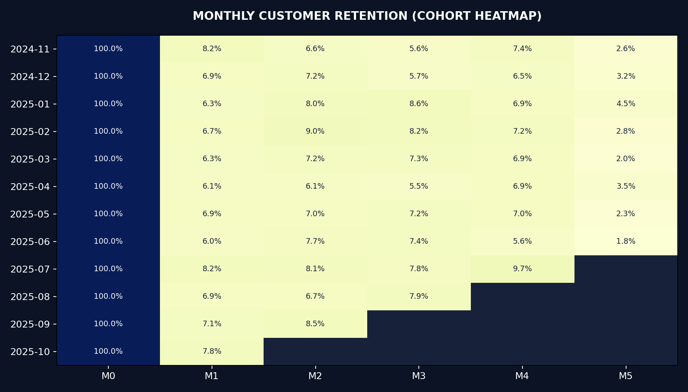

# Customer Retention & Cohort Analysis




**Portfolio project 2/3 · SQL + Python + monthly cohort heatmaps**

## Business problem
Which new customers return for another purchase, and when? Analyze purchase cohorts and produce recommendations for a repeat-purchase experiment.

## Deliverables
- `data/raw/olist_orders_dataset.csv` and `olist_customers_dataset.csv`: **synthetic Olist-shaped demonstration data** (not real marketplace data).
- `sql/retention.sql`: SQL window function to identify first orders for a persistent user ID.
- `scripts/analyze.py`: delivered-order cleaning, safe joins, monthly cohort retention, 30-day repeat purchase, customer-state segments.
- `outputs/dashboard.html`: offline interactive dashboard.
- `outputs/overview.png`: shareable retention heatmap.
- `outputs/cohort_retention.csv`, `outputs/state_segments.csv`, `outputs/eligible_repeat_customers.csv`, `outputs/insights.md`, `outputs/metrics.json`.
- `tests/test_analysis.py` and `notebooks/analysis_walkthrough.ipynb`.

## Run

```bash
python -m pip install -r requirements.txt
python scripts/generate_demo_data.py          # optional: recreate synthetic demo data
python scripts/analyze.py
python -m unittest discover -s tests -v
```

Open `outputs/dashboard.html` directly in a browser.

## Swap in real e-commerce orders (recommended before using on a resume)
Download the original [Olist Brazilian E-Commerce Dataset](https://www.kaggle.com/datasets/olistbr/brazilian-ecommerce) (2016–2018), extract the following two CSVs, then run:

```bash
python scripts/analyze.py \
  --orders /path/to/olist_orders_dataset.csv \
  --customers /path/to/olist_customers_dataset.csv
```

The dashboard and reports will regenerate from real data. Do not present bundled demo results as real results.

## Precisely defined metrics
- Delivered orders only; `customer_id` is an **order-specific record ID**; `customer_unique_id` identifies returning buyers.
- **Month-1 retention**: fraction of first-purchase cohort placing >=1 delivered purchase in the following calendar month. Month 0 = 100%, later months may be blank if incomplete.
- **30-day repeat purchase rate**: fraction of first-time buyers with at least 30 days of follow-up who placed any **additional** delivered order within 30 days after their first.
- Last calendar month is conservatively excluded from later-month retention to avoid partial-month skew.
- These are observed behaviors, not experiment treatment effects. No LTV is estimated without prices.

## Interview talking points
1. Why joining on `customer_unique_id` matters for retention.
2. Why last-month cohorts create right-censoring bias.
3. Difference between month-over-month activity and exact 30-day repurchase windows.
4. How to A/B test a retention campaign.

**Original dataset credit:** Olist / Kaggle, shared under the source dataset's terms. Included sample data is independently **synthetic**.

**Resume suggestion (after running and understanding):** “Developed SQL window-function customer cohort analysis and a Python-based retention dashboard measuring 30-day repurchase rates while excluding incomplete observation windows.”

## Optional one-command public dataset download

Requires internet and dataset access; the bundled synthetic demo works without this. Run `python -m pip install "kagglehub>=1.0.3"`, then `python scripts/download_real_data.py`, then:

```bash
python scripts/analyze.py --orders data/real/olist_orders_dataset.csv --customers data/real/olist_customers_dataset.csv
```

The download helper saves data under `data/real/` to preserve your demo input. The downloader cannot be network-tested in this package environment.
